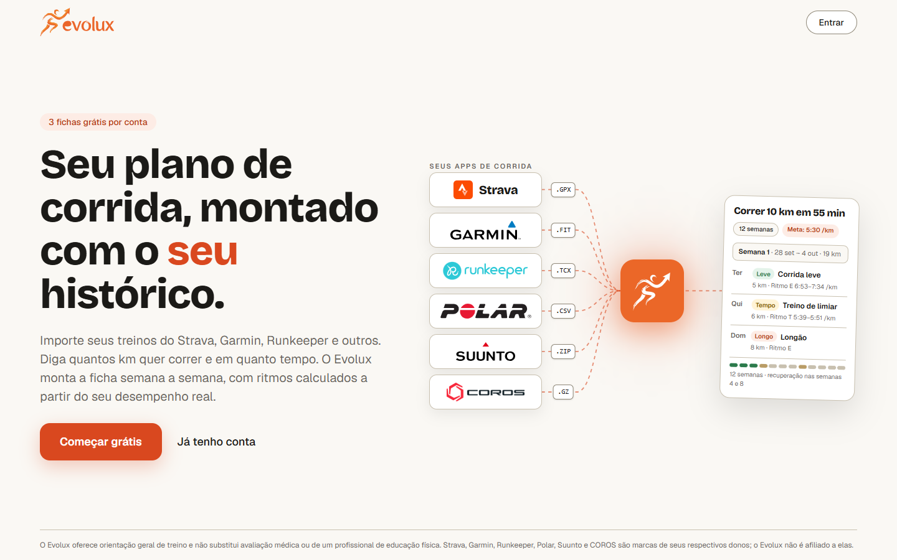
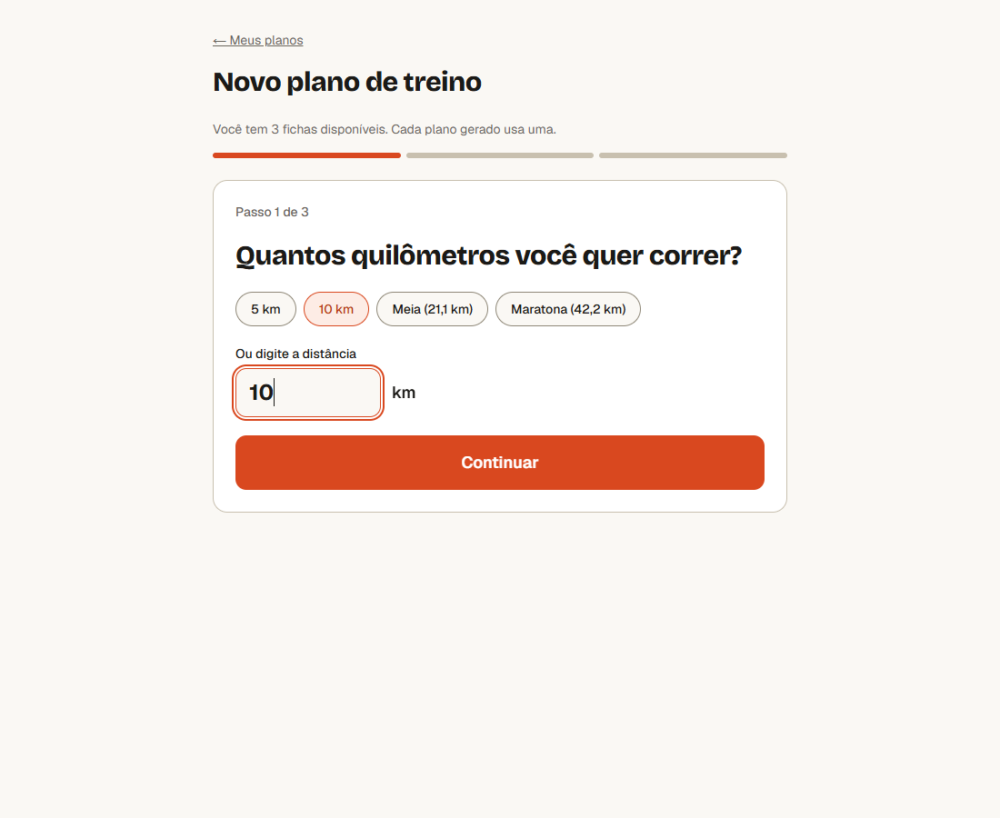
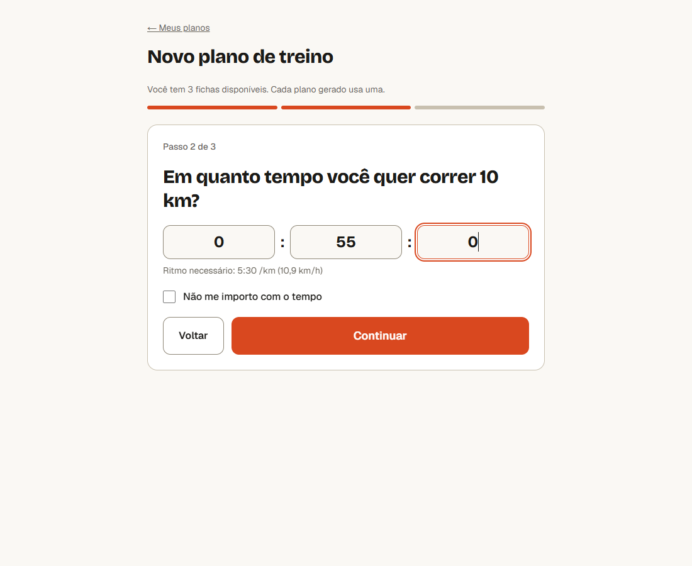
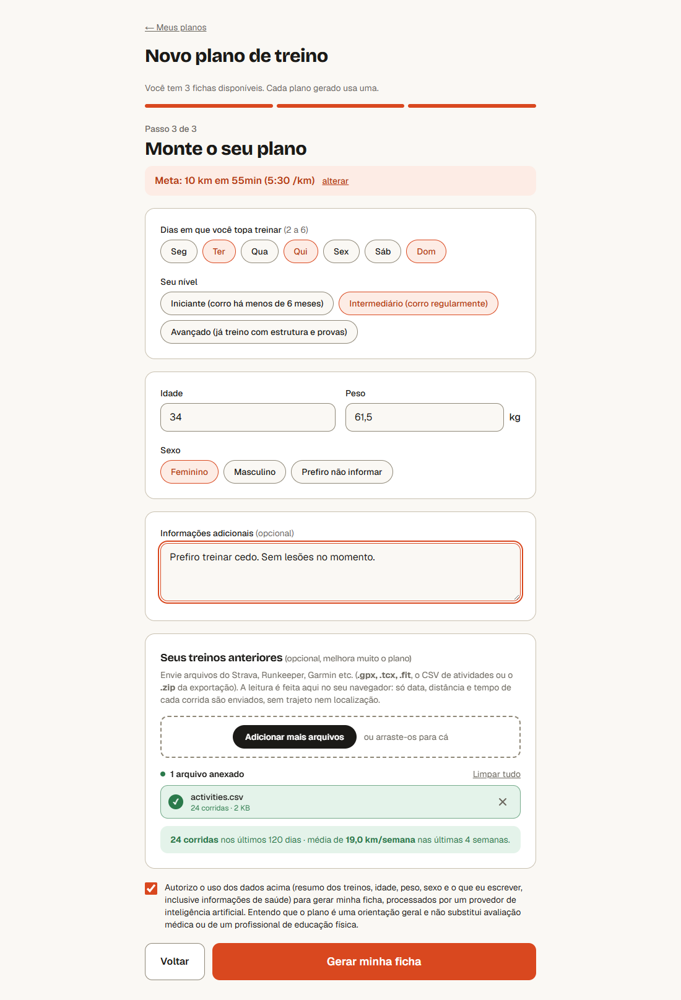
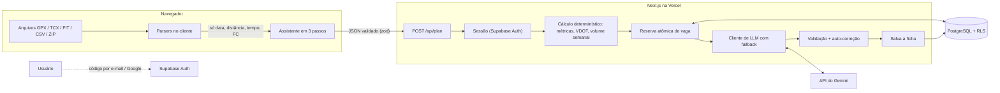

<div align="center">

# Evolux

**Plano de corrida personalizado, montado a partir do seu histórico de treinos.**

Importe os treinos do Strava, Garmin, Runkeeper e outros, diga sua meta e receba uma ficha semana a semana, com ritmos calculados a partir do seu desempenho real.

[**evoluxapp.com.br**](https://evoluxapp.com.br) &nbsp;·&nbsp; produto no ar, com login e geração de fichas

       

</div>

> **TL;DR (English):** Evolux is a production web app that builds personalized running plans. Users import workout files (GPX, TCX, FIT, CSV, ZIP) which are parsed **in the browser** (no GPS tracks leave the device), and the backend combines deterministic training science (VDOT pace zones, progressive-overload volume model) with an LLM that only *writes* the sessions inside strict, code-enforced limits. Passwordless auth, per-account quota enforced atomically in PostgreSQL with Row Level Security, resilient multi-model LLM client, 83 automated tests. The full source is private; this repository documents the architecture, decisions and includes tested code excerpts.

---

## O problema

Aplicativos populares de corrida oferecem planos de treino, mas os recursos personalizados costumam ficar atrás de planos pagos, e planos "de prateleira" ignoram o que a pessoa **realmente** vem correndo. O Evolux resolve isso lendo o histórico exportado do próprio corredor e transformando-o em uma ficha segura, progressiva e específica para a meta dele (por exemplo, "10 km em 55 minutos").

## Como funciona para o usuário

1. **Meta:** quantos quilômetros quer correr e em quanto tempo (ou "não me importo com o tempo").
2. **Perfil:** dias disponíveis, nível, idade, peso, sexo e observações (lesões, preferências). Opcionalmente, anexa os arquivos de treino.
3. **Ficha completa:** de 6 a 16 semanas, com volume, sessões, ritmos por zona, semanas de recuperação, polimento e o dia da meta.

## Telas

> Capturas geradas por script a partir do build de produção do app, rodando contra um backend simulado com **dados de exemplo** (nenhum dado real de usuário).

| Landing (desktop) | Landing (mobile) |
|---|---|
|  |  |

| Assistente em 3 passos | |
|---|---|
|  |  |

| Perfil + arquivos anexados | Ficha gerada |
|---|---|
|  |  |

| Semanas da ficha | Painel |
|---|---|
|  |  |

## Destaques técnicos

| Tema | O que foi feito | Detalhes |
|---|---|---|
| **Ciência no código, texto na IA** | Volume, progressão, ritmos (VDOT), datas e avisos são calculados por algoritmos determinísticos. A LLM só escolhe e escreve as sessões dentro de limites impostos e revalidados em código. | [IA × código](docs/ai-and-scripts.md) |
| **Saída de LLM não é confiável** | Validação por regras, correção automática de casos comuns e nova tentativa com a lista de erros. Se falhar de novo, o pedido é abortado e o usuário não é cobrado. | [`llm-output-guards.ts`](code-samples/typescript/llm-output-guards.ts) |
| **Resiliência de provedor gratuito** | Lista de modelos com prazo por modelo: um 503 lento não consome mais o orçamento da requisição. | [`llm-fallback.ts`](code-samples/typescript/llm-fallback.ts) |
| **Cota à prova de concorrência** | Limite de fichas por conta imposto no banco com `UPDATE` condicional atômico; funções de cota inacessíveis a usuários logados; RLS de leitura. Testado num PostgreSQL embutido. | [`quota-and-rls.sql`](code-samples/sql/quota-and-rls.sql) |
| **Privacidade por projeto** | Arquivos de treino são lidos **no navegador**; só data, distância, tempo e FC saem do dispositivo. Nenhuma coordenada GPS é enviada nem guardada. | [`gpx-parser.ts`](code-samples/typescript/gpx-parser.ts) |
| **Login sem senha** | Código por e-mail e Google. "Mantenha-me conectado" controlado no servidor, alternando entre cookie persistente e cookie de sessão. | [`remember-me-cookies.ts`](code-samples/typescript/remember-me-cookies.ts) |
| **Orquestração testável** | Fluxo de criação do plano com injeção de dependências: autentica, valida, reserva vaga, gera, salva e devolve a vaga em qualquer falha. | [`plan-api-flow.ts`](code-samples/typescript/plan-api-flow.ts) |
| **Design system e acessibilidade** | Tokens semânticos, contraste de bordas medido (≥ 3:1 nos controles), `prefers-reduced-motion`, landing de **uma tela só** (sem rolagem) em 4 tamanhos de celular e desktop. | [`design-tokens.css`](code-samples/css/design-tokens.css) |
| **Qualidade** | 83 testes automatizados (parsers de arquivos reais, algoritmos, cliente de LLM, SQL/RLS) e capturas de tela automatizadas para QA visual. | [Testes](docs/testing.md) |

## Arquitetura



Mais detalhes, sequência de uma requisição e modelo de dados em [`docs/architecture.md`](docs/architecture.md).

## Stack

- **Front-end:** Next.js 16 (App Router, React 19), TypeScript, Tailwind CSS v4, tokens de design próprios
- **Back-end:** rotas de API do Next.js (Node), validação com zod, cliente de LLM independente de provedor
- **Dados e auth:** PostgreSQL (Supabase) com Row Level Security e funções SQL; Supabase Auth (OTP por e-mail e Google)
- **IA:** Google Gemini via API REST, com fallback entre modelos
- **Arquivos:** fast-xml-parser (GPX/TCX), fit-file-parser (FIT), fflate (ZIP/GZ)
- **Infra:** Vercel (deploy pela CLI), domínio próprio, e-mail transacional via SMTP (Resend), cabeçalhos de segurança
- **Testes:** Vitest, PGlite (PostgreSQL em WebAssembly), Puppeteer para capturas de tela

## Sobre o código-fonte

O repositório do aplicativo é **privado**. Aqui você encontra:

```
evolux-portfolio/
├── README.md              você está aqui
├── docs/                  arquitetura, decisões, IA × código, segurança, testes, desafios, competências
├── code-samples/          trechos reais, enxutos e comentados, cada um com testes que rodam de forma independente
│   ├── typescript/        algoritmos, validação de IA, fallback de LLM, parser, cookies, orquestração
│   ├── sql/               esquema com RLS e cota atômica (+ teste em PostgreSQL embutido)
│   ├── react/             componente de lista de arquivos com acessibilidade
│   └── css/               design tokens e animações
└── assets/screenshots/    capturas do produto
```

Os trechos são versões didáticas: simplificam constantes e regras de negócio, mas mantêm a lógica e a técnica.

## Rodando os exemplos

```bash
npm install
npm test          # 40 testes dos exemplos (inclui SQL num PostgreSQL embutido)
npm run typecheck
```

## Competências demonstradas

Front-end moderno, back-end e APIs, modelagem e segurança de banco de dados, integração com LLM em produção, testes, DevOps e UX/acessibilidade. O mapa completo, com onde ver cada evidência, está em [`docs/skills.md`](docs/skills.md).

## Contato

**Pedro Silva** · [LinkedIn](https://www.linkedin.com/in/pedro-lucas-silva-6b1678358/?isSelfProfile=true) · [pedrol09872@gmail.com](mailto:pedrol09872@gmail.com)

## Licença

Todos os direitos reservados. Os textos, imagens e trechos de código deste repositório são apresentados para fins de portfólio e consulta; não podem ser reutilizados comercialmente sem autorização. Veja [`LICENSE`](LICENSE).
