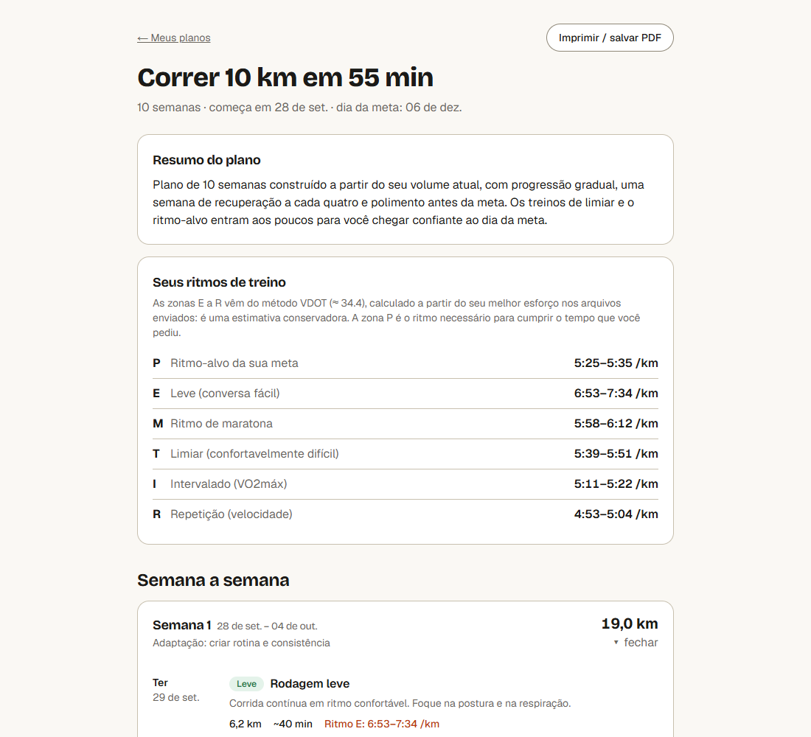
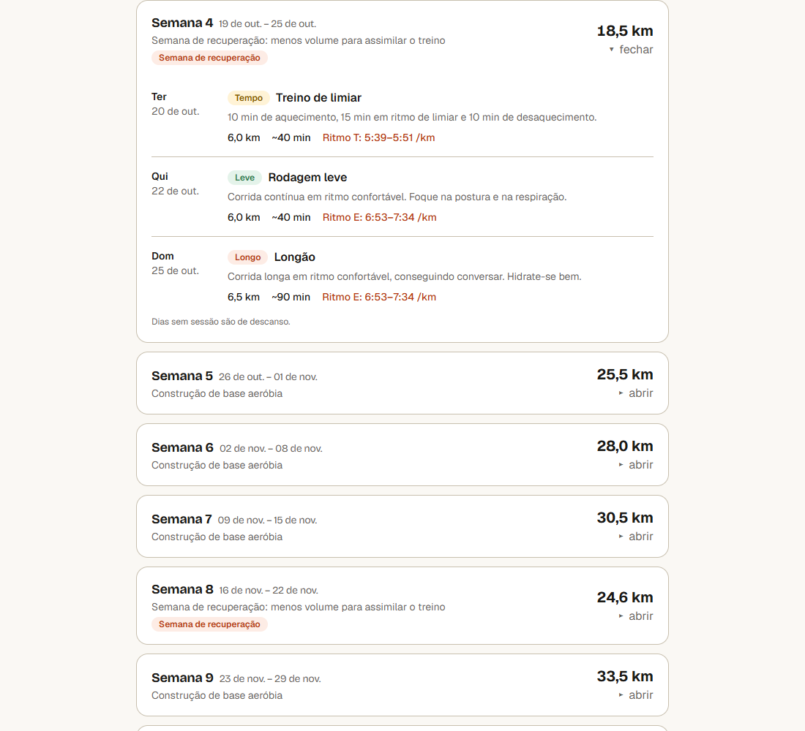
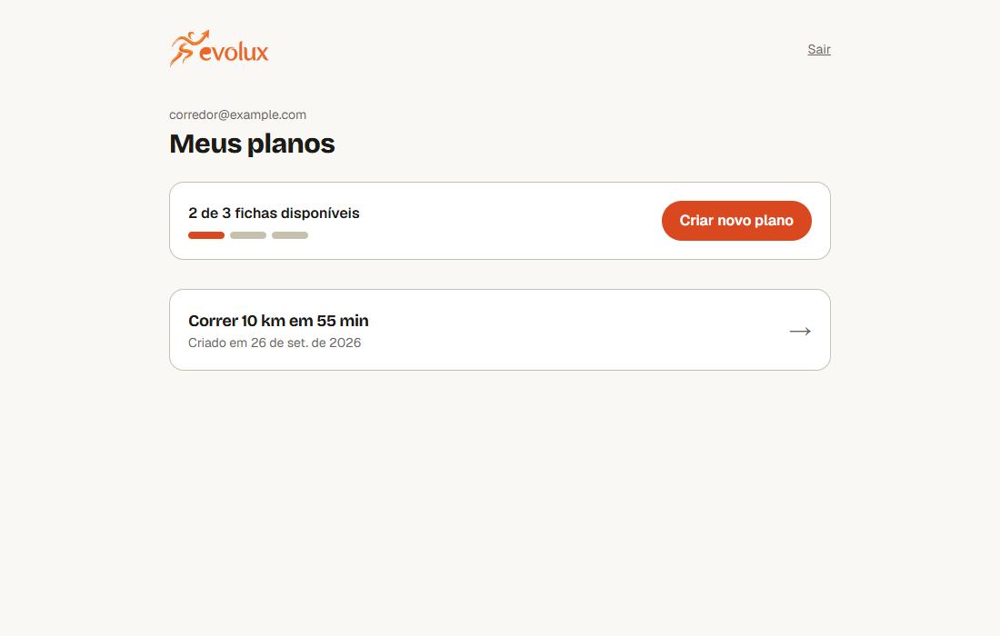
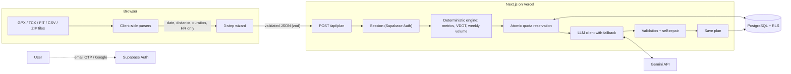

<div align="center">

# Evolux

**Personalized running plan built from your workout history.**

Import workouts from Strava, Garmin, Runkeeper, and others, set your goal, and get a week-by-week training plan with paces calculated from your real performance.

[**evoluxapp.com.br**](https://evoluxapp.com.br) &nbsp;·&nbsp; live in production, with login and plan generation

       

</div>

---

## The Problem

Popular running apps offer training plans, but personalized features are usually locked behind paid tiers, and off-the-shelf plans ignore what the runner has **actually** been doing. Evolux solves this by reading the runner's own exported workout history and turning it into a safe, progressive training plan tailored to their goal (for example, "10 km in 55 minutes").

## How It Works

1. **Goal:** choose the target distance and target time (or "I don't care about time").
2. **Profile:** available days, experience level, age, weight, sex, and notes (injuries, preferences). Optionally attach workout files.
3. **Full plan:** 6 to 16 weeks with weekly volume, workouts, pace zones, cutback weeks, taper, and race/goal day.

## Screenshots

> Captured via script from the production build running against a mock backend with **sample data** (no real user data). The UI shown is in Portuguese, the product's initial launch language.

| Landing (desktop) | Landing (mobile) |
|---|---|
|  |  |

| 3-step wizard | |
|---|---|
|  |  |

| Profile + attached files | Generated plan |
|---|---|
|  |  |

| Plan weeks | Dashboard |
|---|---|
|  |  |

## Technical Highlights

| Topic | What was built | Details |
|---|---|---|
| **Science in code, text in AI** | Volume, progression, pace zones (VDOT), dates, and warnings are computed by deterministic algorithms. The LLM only picks and writes the workouts inside strict limits enforced and revalidated in code. | [AI vs. code](docs/ai-and-scripts.md) |
| **Untrusted LLM output** | Rule-based validation, deterministic normalization for common mistakes, and a self-repair retry with the exact error list. If it fails again, the request aborts and the user's quota is refunded. | [`llm-output-guards.ts`](code-samples/typescript/llm-output-guards.ts) |
| **Free-tier provider resilience** | Configurable model list with a per-model timeout: a slow 503 no longer drains the entire request budget. | [`llm-fallback.ts`](code-samples/typescript/llm-fallback.ts) |
| **Concurrency-safe quota** | Per-account plan limit enforced in PostgreSQL via an atomic conditional `UPDATE`; quota functions revoked from authenticated users; read-only RLS. Tested against embedded PostgreSQL. | [`quota-and-rls.sql`](code-samples/sql/quota-and-rls.sql) |
| **Privacy by design** | Workout files are parsed **in the browser**; only date, distance, duration, and heart rate leave the device. No GPS coordinates are ever sent or stored. | [`gpx-parser.ts`](code-samples/typescript/gpx-parser.ts) |
| **Passwordless login** | Email OTP and Google sign-in. Server-controlled "Keep me signed in" switching between persistent cookies and session cookies. | [`remember-me-cookies.ts`](code-samples/typescript/remember-me-cookies.ts) |
| **Testable orchestration** | Plan creation flow built with dependency injection: authenticates, validates, claims a quota slot, generates, saves, and refunds the slot on any failure. | [`plan-api-flow.ts`](code-samples/typescript/plan-api-flow.ts) |
| **Design system & accessibility** | Semantic tokens, measured border contrast (≥ 3:1 on controls), `prefers-reduced-motion`, and a **single-screen** landing page (no scroll) tested across 4 mobile viewports and desktop. | [`design-tokens.css`](code-samples/css/design-tokens.css) |
| **Quality** | 83 automated tests (real-format file parsers, training algorithms, LLM client, SQL/RLS) plus automated screenshots for visual QA. | [Testing](docs/testing.md) |

## Architecture



More details, request sequence, and data model in [`docs/architecture.md`](docs/architecture.md).

## Tech Stack

- **Front-end:** Next.js 16 (App Router, React 19), TypeScript, Tailwind CSS v4, custom design tokens
- **Back-end:** Next.js Route Handlers (Node), Zod validation, provider-agnostic LLM client
- **Data & Auth:** PostgreSQL (Supabase) with Row Level Security and SQL functions; Supabase Auth (email OTP & Google)
- **AI:** Google Gemini via REST API, with multi-model fallback
- **Files:** fast-xml-parser (GPX/TCX), fit-file-parser (FIT), fflate (ZIP/GZ)
- **Infra:** Vercel (CLI deployments), custom domain, transactional email via SMTP (Resend), security headers
- **Testing:** Vitest, PGlite (PostgreSQL in WebAssembly), Puppeteer for visual QA screenshots

## About the Source Code

The application repository is **private**. Here you will find:

```
evolux-portfolio/
├── README.md              you are here
├── docs/                  architecture, decisions, AI vs. code, security, testing, challenges, skills
├── code-samples/          real, lean, annotated excerpts, each with standalone automated tests
│   ├── typescript/        algorithms, AI guards, LLM fallback, parser, cookies, orchestration
│   ├── sql/               RLS schema and atomic quota (+ embedded PostgreSQL tests)
│   ├── react/             accessible attached-files list component
│   └── css/               design tokens and animations
└── assets/screenshots/    product screenshots
```

The excerpts are didactic versions: they simplify constants and business rules while preserving the core logic and engineering patterns.

## Running the Samples

```bash
npm install
npm test          # 40 sample tests (including SQL on embedded PostgreSQL)
npm run typecheck
```

## Demonstrated Skills

Modern front-end, back-end and APIs, database modeling and security, production LLM integration, testing, DevOps, and UX/accessibility. See the full matrix with links to evidence in [`docs/skills.md`](docs/skills.md).

## Connect With Me

<p align="left">
  <a href="https://pedrosilva.space" target="_blank">
    
  </a>
  <a href="https://www.linkedin.com/in/pedro-lucas-silva-6b1678358/" target="_blank">
    
  </a>
  <a href="https://x.com/pfiuzzzz" target="_blank">
    
  </a>
  <a href="https://www.instagram.com/pfiuz" target="_blank">
    
  </a>
  <a href="mailto:contato@upedrooo.dev">
    
  </a>
</p>

## License

All rights reserved. The texts, images, and code excerpts in this repository are provided for portfolio and reference purposes only; commercial reuse without permission is prohibited. See [`LICENSE`](LICENSE).
