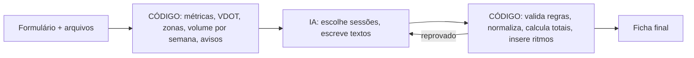

# Onde entra a IA e onde entra o código

**Regra de ouro:** tudo que é número, limite ou segurança é feito por **código determinístico**. A IA só **escolhe e escreve** as sessões, dentro de limites que o código impõe e revalida depois. Ela nunca inventa volume, ritmo ou datas.

Por que separar assim?

- **Exatidão:** modelos de linguagem erram conta. Fórmulas não.
- **Segurança:** um plano de treino mal dimensionado pode machucar. Os limites de progressão não podem depender de um texto gerado.
- **Custo e latência:** com o cálculo pronto, o prompt cabe em ~2 mil tokens e a resposta em ~4 mil, o que roda em modelos gratuitos.
- **Testabilidade:** o que é código tem teste automatizado; o que é IA tem validação automática da saída.

## Feito por código

| O quê | Como |
|---|---|
| **Leitura dos arquivos** | GPX, TCX, FIT, CSV e ZIP viram só data, distância, tempo, FC e altimetria. Filtra corridas plausíveis e remove duplicatas. Roda no navegador. |
| **Análise do histórico** | Km por semana, média das últimas 4 semanas, corridas por semana, treino mais longo, ritmo médio e melhor esforço. |
| **Ritmos de treino** | Zonas leve/maratona/limiar/intervalado/repetição pelo VDOT (modelo de Daniels) e a zona do **ritmo-alvo** da meta pedida. Ver [`pace-zones.ts`](../code-samples/typescript/pace-zones.ts). |
| **Estrutura do plano** | Nº de semanas conforme a distância, volume de cada semana (progressão limitada, recuperação a cada 4ª semana, polimento, semana da meta), tetos por nível e distância, treino longo no fim de semana. Ver [`training-skeleton.ts`](../code-samples/typescript/training-skeleton.ts). |
| **Avisos** | Meta de tempo muito acima do histórico, tempo-alvo sem histórico para avaliar, prazo curto para a distância, ausência de treinos enviados. |
| **Validação da resposta** | Nº de semanas, dias permitidos, um treino longo por semana, volume dentro da meta, limite de sessões intensas, sem intervalado em semana de recuperação, sessão da meta no dia e distância certos. Ver [`llm-output-guards.ts`](../code-samples/typescript/llm-output-guards.ts). |
| **Acabamento** | Soma o km de cada semana (ignora totais da IA), calcula a data de cada sessão, insere as faixas de ritmo a partir da zona escolhida. |
| **Controle de uso** | Limite de fichas por conta, atômico no banco; devolução da vaga em qualquer falha; troca automática de modelo. Ver [`quota-and-rls.sql`](../code-samples/sql/quota-and-rls.sql) e [`llm-fallback.ts`](../code-samples/typescript/llm-fallback.ts). |

## Feito pela IA

- Escolher **quais sessões** cada semana terá (leve, tempo, intervalado, longo, recuperação, força, cross-training) e como dividir o volume da semana entre elas.
- **Escrever** títulos e descrições, o foco e a dica de cada semana e o resumo do plano.
- Escolher a **zona de ritmo** de cada sessão. O valor numérico do ritmo é inserido pelo código.
- Interpretar as **informações adicionais** do usuário (por exemplo, uma lesão) e reduzir o impacto, incluindo cross-training e um aviso para buscar avaliação profissional.

## Como a IA é contida

1. **Prompt com regras explícitas** e estrutura pronta (volume por semana, dias, zonas disponíveis).
2. **Texto do usuário tratado como dado**, delimitado no prompt, com instrução de ignorar qualquer pedido dentro dele.
3. **Saída em JSON** validada por esquema (zod) e depois por regras de negócio.
4. **Autocorreção:** na reprovação, uma nova tentativa recebe a lista exata de erros. Se falhar de novo, o pedido é abortado e a cota do usuário é devolvida.

## Limites conhecidos (e como seriam tratados)

- O **conteúdo** de cada treino (por exemplo, a estrutura de um intervalado) é da IA e só é validado em parte: o código garante quilometragem, dias e tipo, mas não a qualidade da progressão interna nem a coerência entre duração, distância e ritmo.
- Lesões e condições de saúde dependem da interpretação do modelo; o código só limita a quantidade e o tipo de sessões intensas.
- Os ritmos estimados a partir do histórico são **conservadores**, porque treinos costumam ser mais leves que uma prova.
- O prompt pede ±10% no volume semanal, enquanto o código aceita ±15%, para não reprovar um bom plano por pouco.
