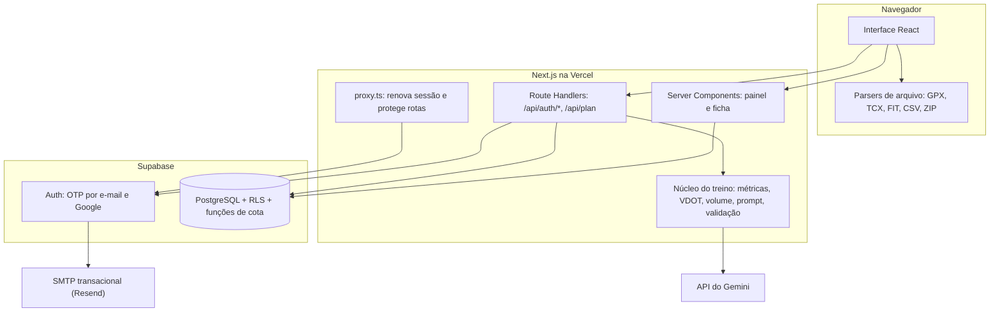
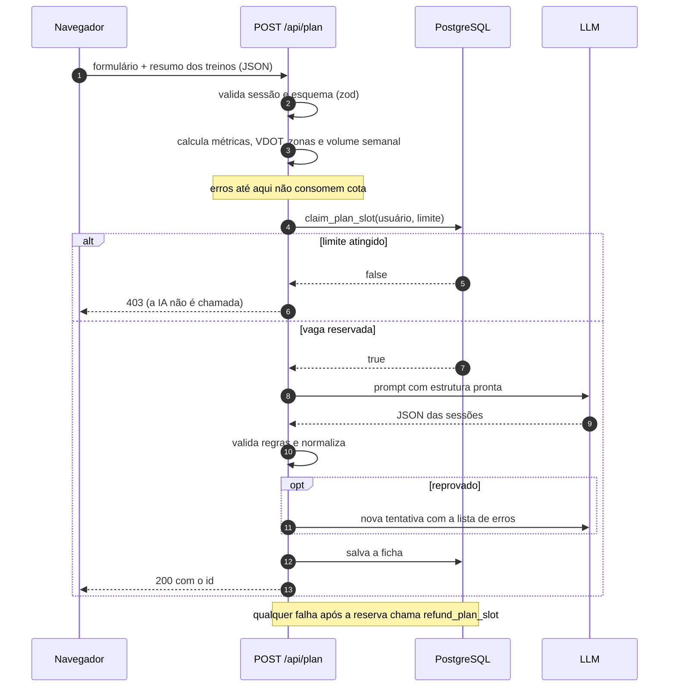
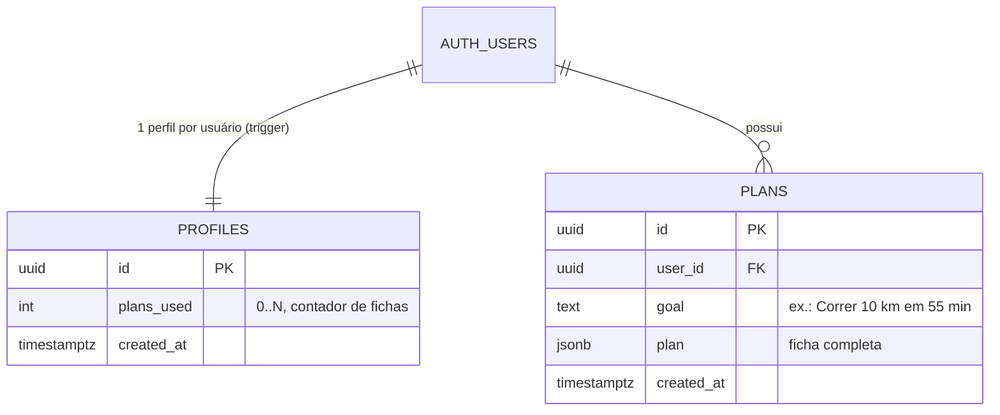

# Arquitetura

## Visão geral

O Evolux é uma aplicação **Next.js (App Router)** hospedada na Vercel, com **Supabase** (PostgreSQL + Auth) como camada de dados e uma **LLM** (Google Gemini) usada apenas para redigir as sessões de treino. Todo o restante da inteligência do plano é código determinístico.



## Ciclo de uma requisição de plano



## Modelo de dados



- **Leitura:** o usuário lê só as próprias linhas (políticas RLS).
- **Escrita:** somente pelo servidor, com a chave de serviço.
- **Cota:** funções `claim_plan_slot` e `refund_plan_slot`, executáveis apenas pelo papel de serviço.

## Camadas do código (repositório privado)

```
app/            páginas (landing, login, painel, novo plano, ficha) e rotas de API
components/     assistente de 3 passos, login, logo, ilustração de integração
lib/parsing/    leitura de GPX, TCX, FIT, CSV, ZIP e GZ (roda no navegador)
lib/coach/      métricas, VDOT/ritmos, esqueleto de volume, prompt, validações
lib/llm/        cliente de LLM com fallback de modelos e prazos
lib/supabase/   clientes (servidor, admin, proxy) e política de cookies de sessão
proxy.ts        renovação de sessão e proteção de rotas (substitui o middleware no Next 16)
supabase/       migração SQL: tabelas, RLS, gatilhos e funções
tests/          testes unitários, de SQL e servidor simulado para testes manuais
```

## Implantação

- **Hospedagem:** Vercel, com deploy de produção pela CLI e variáveis de ambiente separadas entre públicas (`NEXT_PUBLIC_*`) e secretas.
- **Domínio:** domínio próprio com HTTPS automático; `www` redireciona para o domínio principal.
- **E-mail:** códigos de acesso enviados por SMTP transacional a partir do domínio verificado.
- **Segurança em produção:** cookies `Secure`, cabeçalhos (`X-Content-Type-Options`, `X-Frame-Options`, `Referrer-Policy`, `Permissions-Policy`), `robots.txt` e `sitemap.xml`. Detalhes em [security.md](security.md).
