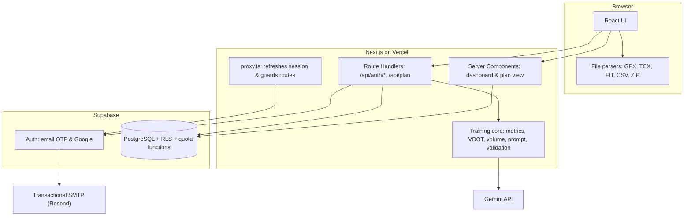
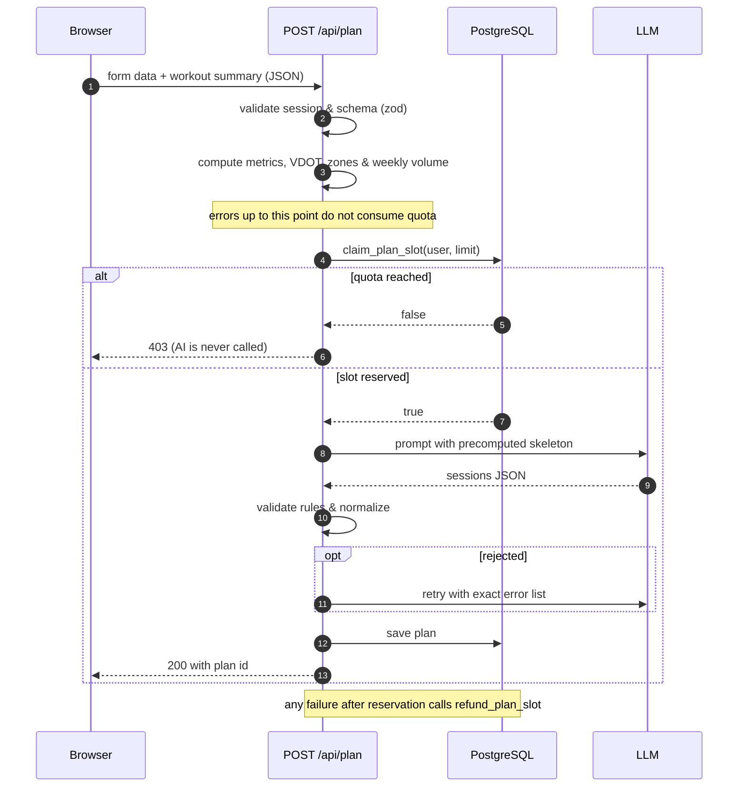
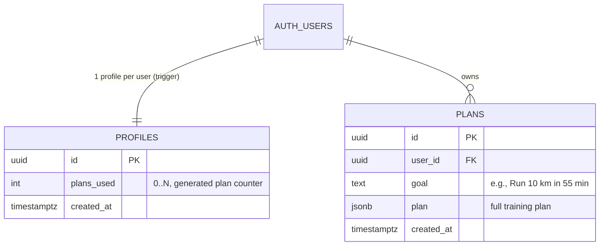

# Architecture

## Overview

Evolux is a **Next.js (App Router)** application hosted on Vercel, backed by **Supabase** (PostgreSQL + Auth) and an **LLM** (Google Gemini) used strictly to write the training sessions. Everything else in the training engine is deterministic code.



## Plan Request Lifecycle



## Data Model



- **Reads:** users can only read their own rows (RLS policies).
- **Writes:** server-only, using the service role key.
- **Quota:** `claim_plan_slot` and `refund_plan_slot` functions, executable only by `service_role`.

## Codebase Layers (Private Repository)

```
app/            pages (landing, login, dashboard, new plan, plan view) & API routes
components/     3-step wizard, login, logo, integration illustration
lib/parsing/    GPX, TCX, FIT, CSV, ZIP, and GZ parsers (runs in the browser)
lib/coach/      metrics, VDOT/paces, volume skeleton, prompt builder, validators
lib/llm/        LLM client with model fallback and timeouts
lib/supabase/   clients (server, admin, proxy) & session cookie policy
proxy.ts        session refresh & route protection (replaces middleware in Next 16)
supabase/       SQL migration: tables, RLS, triggers, and functions
tests/          unit tests, SQL tests, and mock server for manual testing
```

## Deployment

- **Hosting:** Vercel, deployed via CLI with environment variables split between public (`NEXT_PUBLIC_*`) and server-only secrets.
- **Domain:** custom domain with automatic HTTPS; `www` redirects to the apex domain.
- **Email:** sign-in codes sent over transactional SMTP from the verified domain.
- **Production hardening:** `Secure` cookies, security headers (`X-Content-Type-Options`, `X-Frame-Options`, `Referrer-Policy`, `Permissions-Policy`), `robots.txt`, and `sitemap.xml`. See [security.md](security.md) for details.
